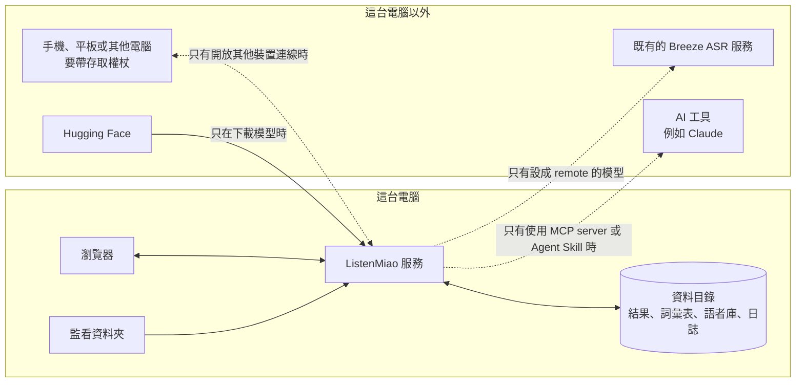

# 隱私權政策

最後更新：2026-11-08

ListenMiao is self-hosted, open-source software. The developer runs no servers and collects no data: audio, transcripts, the glossary and voiceprints stay in the data directory of the computer that runs the service. Data leaves that computer only when it downloads models from Hugging Face, when you let other devices connect, when you configure a remote Breeze ASR inference service, or when an AI tool you connect through the MCP server or the Agent Skill (such as Claude) receives transcripts. It contacts GitHub only when you check for or apply an update. OpenVINO, NNCF and Hugging Face telemetry is turned off.

ListenMiao 是在你自己電腦上執行的開源軟體，與 MediaTek 無關。開發者不經營任何伺服器，也不收集、接收或看到你的錄音、逐字稿與使用情形；沒有帳號、沒有分析追蹤、沒有廣告。以下說明服務在你的電腦上存了什麼、什麼情況下會連到外面，以及怎麼刪除。

**本頁**：[資料流向](#資料流向) · [存在這台電腦的資料](#存在這台電腦的資料) · [瀏覽器裡的資料](#瀏覽器裡的資料) · [會連到外面的情況](#會連到外面的情況) · [用量回報](#用量回報) · [刪除資料](#刪除資料) · [說話者的同意](#說話者的同意) · [政策變更與聯絡](#政策變更與聯絡)

## 資料流向

圖的文字說明：瀏覽器、監看資料夾、ListenMiao 服務與資料目錄都在這台電腦上，錄音與結果不會離開這台電腦。對外連線只有下面「會連到外面的情況」列的幾種。

## 存在這台電腦的資料

都放在 `ASR_DATA_DIR`（預設是專案資料夾裡的 `data`；Docker 版是 `asr-data` volume）：

| 資料 | 內容 | 保留多久 |
| --- | --- | --- |
| 上傳的音訊 | 原檔解碼成 16 kHz 單聲道後暫存 | 原檔解碼完就刪除，解碼後的音訊辨識完成就刪除；服務重新啟動時也會清掉 |
| 辨識結果（`results/`） | 逐字稿、時間、說話者名字、各說話者的聲紋、上傳的檔名、熱詞 | 從完成或最後一次修改起算 `ASR_JOB_TTL_SECONDS`（預設 1 天）後刪除 |
| 燒錄字幕（`renders/`） | 燒好字幕的影片 | 上傳的影片燒完就刪除；燒好的影片保留 `ASR_JOB_TTL_SECONDS`，服務重新啟動時也會刪除 |
| 詞彙表（`glossary.json`） | 熱詞與取代規則 | 直到你修改 |
| 語者庫（`voices/`） | 你按「記住聲音」的人的名字與聲紋 | 直到你在「語者庫」刪除 |
| 日誌（`logs/`） | 見下方 | 依 `ASR_LOG_FILE_MB`、`ASR_LOG_FILE_COUNT` 輪替，舊檔自動覆蓋 |
| 模型與設定 | 轉換後的模型、編譯快取、硬體設定檔 | 不含你的資料 |

- 日誌會記：上傳的檔名、工作編號、處理時間、錯誤訊息、被拒絕的請求（路徑與主機名稱）、登入的來源位址，以及瀏覽器回報的 JavaScript 錯誤訊息與瀏覽器版本（User-Agent）。不記逐字稿、熱詞內容、說話者名字與權杖（包括送來的錯誤權杖）。見[日誌](docs/deployment.md#日誌)。
- 監看資料夾：服務讀取 `ASR_WATCH_DIR` 裡的錄音，在同一個資料夾寫出結果檔與 `.error.txt`，不會刪除或修改原檔。
- 命令列工具寫出的結果檔放在你指定的位置；網頁匯出的檔案由瀏覽器下載到你選的位置。這些檔案不會自動刪除。
- 更新時下載的新版與更新前的備份放在專案資料夾的 `.update/`，下次更新時覆蓋；不含你的資料。
- 模型的下載快取放在 Hugging Face 的 `HF_HOME`（原生安裝通常是 `%USERPROFILE%\.cache\huggingface`，Docker 版在 `asr-data` volume 裡），只有模型檔。

## 瀏覽器裡的資料

- `localStorage` 只記介面選項：上次選的模型、檢視方式、說話者與標點選項、是否使用熱詞，以及上次開啟的工作編號。不含錄音、逐字稿或熱詞內容。
- 在網頁錄的音，按「辨識」之前只存在這個分頁的記憶體裡；選的檔案也一樣，都不會寫進瀏覽器的儲存空間。
- 服務設了存取權杖時，登入後會留一個 cookie（`breeze_asr_session`），`HttpOnly`、`SameSite=Strict`，以 HTTPS 開啟時加上 `Secure`，有效 400 天。它的值是由權杖導出的雜湊，不是權杖本身。

## 會連到外面的情況

1. **下載模型**：第一次啟動或 `models.json` 換了模型時，從 [Hugging Face](https://huggingface.co/privacy) 下載辨識、分辨說話者與標點的模型。Hugging Face 會看到你的 IP 位址與下載的檔案；錄音與逐字稿不會上傳。
2. **讓其他裝置連線**：你開放手機、平板或其他電腦連線時，錄音與逐字稿在那台裝置與服務之間傳送。用 http 連線時都是明文，離開這台電腦的連線請用 HTTPS（見 [SECURITY.md](SECURITY.md)）。
3. **轉呼叫遠端服務**：`models.json` 裡設成 `remote` 的模型，會把音訊（WAV）送到你指定的 Breeze ASR 服務，由那個服務的政策規範。
4. **MCP server 與 Agent Skill**：AI 助理透過 MCP server 或 Agent Skill 取得的逐字稿、檔名、說話者名字與工作清單，會進到你的 AI 工具（例如 Claude）的對話，可能因此送到該 AI 服務，由該服務的政策規範。MCP server 本身只連 `.env` 指定的 ListenMiao 服務；Skill 附的腳本只連你用 `--url` 或 `ASR_HOST`、`ASR_PORT` 指定的 ListenMiao 服務。
5. **安裝與更新**：安裝腳本從 astral.sh 下載 uv，再從 PyPI 與 PyTorch 的套件庫下載套件；Docker 版從 GitHub Container Registry 下載映像檔，自己建置時還會下載基底映像檔與系統套件。用 `bunx skills add` 安裝 Agent Skill 時，會從 npm 下載 `skills` 指令，再從 GitHub 下載 Skill。按網頁上的「檢查更新」、「立即更新」或執行更新腳本時，才會連到 GitHub 查詢最新版本、下載新版與更新程式，GitHub 會看到你的 IP 位址；平常不會連線，也不會送出任何使用資料。

除此之外，服務不會連到任何地方，也不會把資料送給開發者。

## 用量回報

- ListenMiao 本身不送任何用量統計或錯誤回報；網頁的 JavaScript 錯誤只回報給你自己的服務，記在日誌裡。
- OpenVINO 與 NNCF 預設會把用量統計（套件版本、作業系統、權重壓縮參數與一組固定的識別碼，不含錄音與字幕）送到 Google Analytics。推論子行程每次啟動、載入 OpenVINO 之前，會寫入 OpenVINO 自己的設定檔把它關閉（Windows 是 `%LOCALAPPDATA%\Intel Corporation\openvino_telemetry`，Linux、macOS 是 `~/intel/openvino_telemetry`），所以這台電腦上其他 OpenVINO 工具的用量回報也會一起關閉。
- Hugging Face 的用量回報由 `.env` 的 `HF_HUB_DISABLE_TELEMETRY=1` 關閉。

## 刪除資料

- 辨識結果到期自動刪除；要提早刪除，停止服務後刪掉 `ASR_DATA_DIR/results` 裡以工作編號命名的檔案。
- 語者庫在工具列的「語者庫」刪除，保留中的結果裡對應到這個人的說話者也會解除對應。
- 全部刪除：停止服務後刪掉整個 `ASR_DATA_DIR`。Docker 版用 `docker compose down -v`，會連同 `asr-data` volume（含模型快取）一起刪除。
- 瀏覽器：清除服務網址的網站資料，就會刪掉介面選項與登入 cookie。

## 說話者的同意

錄音與逐字稿可能含有別人的個人資料，聲紋更屬於個人生物特徵。分辨說話者、記住別人的聲音之前，請依所在地的個人資料法規取得對方同意；不再需要時從「語者庫」刪除。

## 政策變更與聯絡

這份政策的變更記在 git 歷史與 [CHANGELOG.md](CHANGELOG.md)。有問題請在 [GitHub](https://github.com/Scorpio-meow/ListenMiao/issues) 開 issue；涉及安全性的問題請依 [SECURITY.md](SECURITY.md#回報漏洞) 私下回報。
