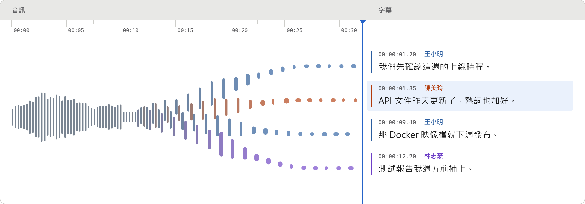
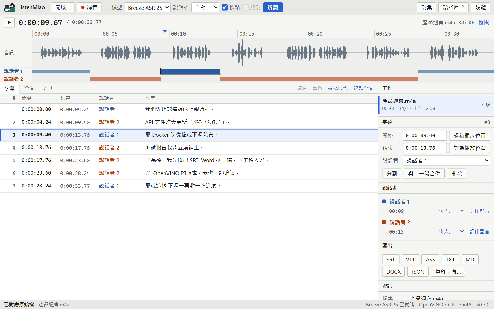
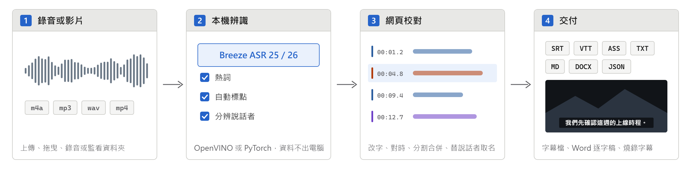

<div align="center">

<picture>
  <source media="(prefers-color-scheme: dark)" srcset="docs/brand/listenmiao-logo-dark.svg">
  
</picture>

# ListenMiao

**在自己的電腦上，把會議錄音、課程與影片轉成可以校對的字幕與逐字稿。**

[](https://github.com/Scorpio-meow/ListenMiao/releases/latest)
[](https://github.com/Scorpio-meow/ListenMiao/actions/workflows/ci.yml)
[](https://www.python.org/)
[](https://fastapi.tiangolo.com/)
[](https://github.com/openvinotoolkit/openvino)
[](docs/deployment.md#docker)
[](LICENSE)
[](https://m8ven.ai/mcp/scorpio-meow/breeze-asr?s=readme)

[官網](https://scorpio-meow.github.io/ListenMiao/) · [快速開始](#快速開始) · [功能](#功能) · [系統需求](#系統需求) · [常用設定](#常用設定) · [文件](#文件) · [更新紀錄](CHANGELOG.md)

</div>

<picture>
  <source media="(prefers-color-scheme: dark)" srcset="docs/images/hero-dark.png">
  
</picture>

用 MediaTek Research 的 Breeze ASR 25／26 模型辨識臺灣華語、中英夾雜與臺灣台語，自動加標點、分辨說話者，在網頁上校對後匯出字幕檔或 Word 逐字稿。可以完全在本機執行，錄音不必上傳到任何雲端服務。

https://github.com/user-attachments/assets/c193e0a1-94d4-4cf1-b923-9589382603f6

> [!NOTE]
> 這是使用 MediaTek Research 釋出的 [Breeze ASR](https://huggingface.co/MediaTek-Research/Breeze-ASR-25) 模型的非官方專案，與 MediaTek 無關。

A local web app for transcribing speech with the Breeze ASR 25/26 models: waveform timeline, subtitle editor with undo, hotwords, automatic punctuation, speaker diarization with a voice library, video preview and subtitle burn-in, a watched folder, a CLI, an MCP server and an Agent Skill, and SRT/VTT/ASS/TXT/Markdown/DOCX/JSON export. Unofficial; not affiliated with MediaTek.



## 快速開始

不確定用哪一種方式，見[部署](docs/deployment.md)開頭的比較表。

### 1. 下載

從 [Releases](https://github.com/Scorpio-meow/ListenMiao/releases/latest) 下載 `listenmiao-<版本>.zip` 並解壓縮，不需要 git。之後按網頁右下角的版本號就能檢查與套用更新，見[更新版本](docs/deployment.md#更新版本)。

### 2. 安裝並啟動

安裝腳本會自動安裝 [uv](https://docs.astral.sh/uv/) 與符合顯示卡的 PyTorch（CPU、CUDA 或 ROCm），並從 `.env.example` 建立 `.env`。

**Windows**：在專案根目錄開 PowerShell 執行下面的指令，裝好後點桌面的「ListenMiao」捷徑啟動。

```powershell
powershell -ExecutionPolicy Bypass -File scripts\install.ps1
```

**Linux、macOS（Apple Silicon）**：在專案根目錄執行安裝腳本。

```bash
bash scripts/install.sh
```

`.env.example` 的字幕字型是 Windows 的設定，沒改的話服務會拒絕啟動。先把 `.env` 的 `ASR_SUBTITLE_FONT`、`ASR_SUBTITLE_FONTS_DIR` 改成系統裡有的中文字型（見[字幕字型](docs/deployment.md#字幕字型)），再啟動：

```bash
bash scripts/start.sh
```

**Docker**：容器內一律監聽 `0.0.0.0`，所以複製 `.env` 後要先把 `ASR_ACCESS_TOKEN` 設成一組權杖（見[存取權杖](docs/configuration.md#存取權杖)），否則服務會拒絕啟動。

```bash
cp .env.example .env
docker compose up -d --build
```

NVIDIA、AMD 顯示卡與 GitHub 發布的映像檔，見[部署](docs/deployment.md#docker)。

> [!IMPORTANT]
> 第一次啟動會下載約 9 GB 的模型並[自動調校](docs/how-it-works.md#自動調校)，約需數分鐘到十幾分鐘，進度顯示在底部狀態列；之後啟動約 15 秒就緒。見[第一次啟動](docs/deployment.md#第一次啟動)。

### 3. 開始辨識

開啟 <http://127.0.0.1:7860>（Windows 的捷徑會在服務就緒後自動開啟），把音訊或影片拖進視窗（或按「開啟…」），再按「辨識」。完成後在網頁上校對，從「匯出」下載字幕或逐字稿。

### 4. 讓 AI 工具使用（選用）

服務啟動後，安裝 [Agent Skill](docs/cli.md#agent-skill)，Claude Code、Codex 等 AI 工具就能幫你轉逐字稿、替說話者改名、整理會議紀錄與燒錄字幕。

```bash
bunx skills add Scorpio-meow/ListenMiao --skill listenmiao -g
```

沒有 [Bun](https://bun.sh) 的話，把 `bunx` 換成 `npx`。各工具的資料夾、手動安裝與更新方式見[安裝 Skill](docs/cli.md#安裝-skill)。

## 功能

<picture>
  <source media="(prefers-color-scheme: dark)" srcset="docs/images/pipeline-dark.png">
  
</picture>

**辨識**

- **上傳與錄音**：上傳音訊或影片（m4a、mp3、wav、mp4 等常見格式，可一次選多個排隊）、拖進視窗或用瀏覽器錄音；顯示排隊位置與預估時間，排隊中或處理中都能取消
- **熱詞**：先給人名、公司名與術語，辨識時比較容易寫對；詞彙表的取代規則自動修正同音字
- **自動標點**：辨識完用獨立的標點模型補上全形標點
- **[分辨說話者](docs/how-it-works.md#分辨說話者)**：自動判斷或指定人數；取名後存進語者庫，之後自動認出；分錯時可以合併或改給別人

**校對與輸出**

- **字幕編輯**：波形時間軸、影片預覽疊上字幕、直接改字、對時、分割合併、尋找取代、復原與重做
- **工作清單**：保留中的結果都列在「工作」，重新整理後自動開啟上次那一份
- **匯出**：SRT、VTT、ASS、TXT、Markdown、DOCX、JSON，也能把字幕燒錄到原始影片

**自動化**

- **[監看資料夾](docs/deployment.md#監看資料夾)**：放進去的錄音自動辨識，結果寫在原檔旁邊
- **[命令列工具、MCP server 與 Agent Skill](docs/cli.md)**：批次轉檔，或讓 Claude 等 AI 工具直接呼叫；裝上 [Skill](skills/listenmiao/SKILL.md) 後，AI 會自己轉逐字稿、替說話者改名、整理會議紀錄與燒錄字幕

**硬體**

- **[自動調校](docs/how-it-works.md#自動調校)**：選用 OpenVINO（CPU、Intel 內顯）或 PyTorch（NVIDIA CUDA、AMD ROCm），也能在工具列的「硬體」改用其他實測過的設定
- **轉呼叫遠端服務**：在 `models.json` 把模型設成 [`remote`](docs/configuration.md#remote)，轉呼叫既有的 Breeze ASR 服務

## 支援的模型

| 模型 | 適用情境 |
| --- | --- |
| [Breeze ASR 25](https://huggingface.co/MediaTek-Research/Breeze-ASR-25) | 臺灣華語、中英夾雜；時間戳記準，適合做字幕 |
| [Breeze ASR 26](https://huggingface.co/MediaTek-Research/Breeze-ASR-26) | 臺灣台語，輸出華語漢字 |

其他 Whisper 架構的模型，在 `models.json` 加一筆就能使用，見[設定](docs/configuration.md#modelsjson)。

## 系統需求

| 項目 | 需求 |
| --- | --- |
| 作業系統 | Windows（x64）、Linux、macOS 14 以上（Apple Silicon，未實機實測），或任何能執行 Docker 的系統；Windows ARM64 與 Intel Mac 無法原生安裝，見[不支援或未實測的硬體](docs/deployment.md#不支援或未實測的硬體) |
| Python | 3.12（uv 會自動下載） |
| 記憶體 | 建議 16 GB 以上；第一次轉換模型時峰值約 9.5 GB，8 GB 也能完成，但會大量使用分頁檔 |
| 磁碟 | 約 16 GB（原始權重、轉換後的模型、編譯快取）；第一次自動調校期間暫時多約 4–7 GB |
| 加速 | Intel 內顯（OpenVINO）、NVIDIA GPU（CUDA）、AMD GPU（ROCm，僅 Linux），沒有也能用 CPU；Intel NPU 與 Qualcomm 的 NPU、GPU 都用不到，見 [GPU 支援](docs/deployment.md#gpu-支援) |

## 常用設定

服務的設定都在 `.env`，每個變數都必須填寫，缺少或格式錯誤時服務會拒絕啟動並說明原因。最常改的幾個如下，完整清單、`models.json` 與硬體設定檔見[設定](docs/configuration.md)。

| 變數 | 用途 | `.env.example` |
| --- | --- | --- |
| `ASR_HOST`、`ASR_PORT` | 監聽位址與埠 | `127.0.0.1`、`7860` |
| `ASR_ACCESS_TOKEN` | [存取權杖](docs/configuration.md#存取權杖)；`ASR_HOST` 不是本機位址或用 Docker 時必須設定 | `off` |
| `ASR_ALLOWED_HOSTS` | [接受的主機名稱](docs/configuration.md#接受的主機名稱)，讓其他裝置連線時要加上它們網址裡的名稱 | `127.0.0.1,localhost` |
| `ASR_SUBTITLE_FONT`、`ASR_SUBTITLE_FONTS_DIR` | ASS 匯出與燒錄字幕的[字型](docs/deployment.md#字幕字型) | `"Microsoft JhengHei"`、`C:/Windows/Fonts` |
| `ASR_MAX_UPLOAD_MB`、`ASR_MAX_AUDIO_SECONDS` | 單檔大小與音訊長度上限 | `2048`、`10800`（2 GB、3 小時） |
| `ASR_JOB_TTL_SECONDS` | 辨識結果保留多久，從最後一次修改起算 | `86400`（1 天） |
| `ASR_WATCH_DIR` | [監看資料夾](docs/deployment.md#監看資料夾)；不監看填 `off` | `off` |

## 文件

| 文件 | 內容 |
| --- | --- |
| [部署](docs/deployment.md) | 安裝腳本、Docker、更新版本、從其他電腦與手機連線、監看資料夾、日誌、GPU 支援 |
| [設定](docs/configuration.md) | `.env`、`models.json`、硬體設定檔 |
| [運作方式](docs/how-it-works.md) | 架構、自動調校、句子分段、分辨說話者與語者庫、熱詞、自動標點、編輯與燒錄字幕 |
| [API](docs/api.md) | 各端點的參數與回應；機器可讀的規格是 [`openapi.yaml`](docs/openapi.yaml) |
| [命令列工具、MCP server 與 Agent Skill](docs/cli.md) | 批次轉檔、讓 MCP 用戶端呼叫、安裝給 AI 工具用的 Skill |
| [效能實測](docs/benchmarks.md) | 辨識速度、自動調校、句子分段、分辨說話者、熱詞 |
| [Agent Skill](skills/listenmiao/SKILL.md) | 給 AI 工具讀的操作說明（英文） |
| [更新紀錄](CHANGELOG.md) | 各版本的變更 |
| [隱私權政策](PRIVACY.md)、[安全性](SECURITY.md) | 資料存放與對外連線；部署範圍、已有的防護與漏洞回報 |
| [第三方聲明](NOTICE.md) | 模型、範例語音與參考程式碼的授權 |

## 安全性與隱私

> [!WARNING]
> `.env.example` 只監聽 `127.0.0.1`、不需要存取權杖。讓手機、平板或其他電腦連線前，必須設定存取權杖並把網址裡的名稱加進 `ASR_ALLOWED_HOSTS`（見[從手機或平板使用](docs/deployment.md#從手機或平板使用)），也請先看 [SECURITY.md](SECURITY.md)。

錄音、逐字稿、詞彙表與語者庫都只存在本機的資料目錄；聲紋屬於個人生物特徵，記住別人的聲音前請先取得對方同意。資料存在哪裡、保留多久、會送到哪裡，見[隱私權政策](PRIVACY.md)。

## 無障礙

介面以 WCAG 2.2 AA 為目標，主要工作只用鍵盤就能完成。支援的環境、已知限制與回報方式見 [ACCESSIBILITY.md](ACCESSIBILITY.md)。

## 參與開發

歡迎回報問題、提出建議與送 Pull Request。開發環境、提交前檢查與 issue 範本見 [CONTRIBUTING.md](CONTRIBUTING.md)，行為準則見 [CODE_OF_CONDUCT.md](CODE_OF_CONDUCT.md)。

## 授權

程式碼以 [MIT](LICENSE) 授權釋出。模型、範例語音與參考的程式碼各有授權，見 [NOTICE.md](NOTICE.md)；模型都是執行時從 Hugging Face 下載，不隨本專案散布。
