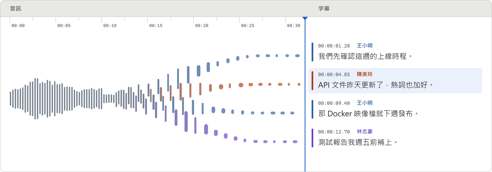
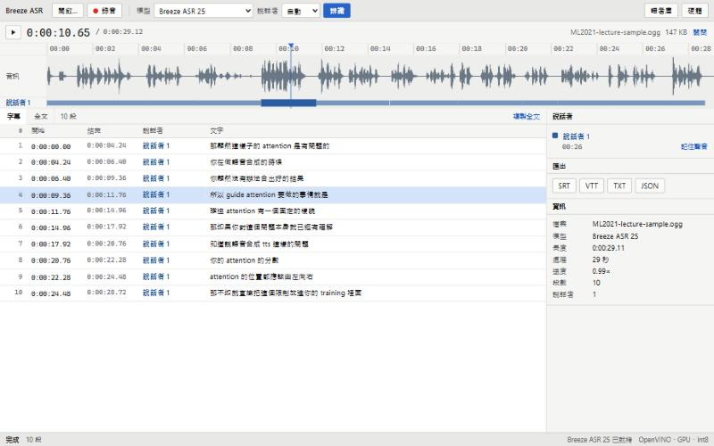
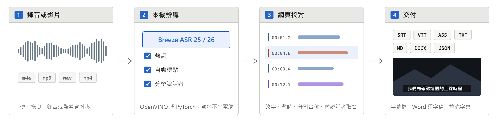

<div align="center">

# Breeze ASR 網頁 APP

**在自己的電腦上，把會議錄音、課程與影片轉成可以校對的字幕與逐字稿。**

[](https://www.python.org/)
[](https://fastapi.tiangolo.com/)
[](https://github.com/openvinotoolkit/openvino)
[](docs/deployment.md#docker)
[](LICENSE)

[快速開始](#快速開始) · [功能](#功能) · [系統需求](#系統需求) · [文件](#文件) · [更新紀錄](CHANGELOG.md)

</div>

<picture>
  <source media="(prefers-color-scheme: dark)" srcset="docs/images/hero-dark.png">
  
</picture>

用 MediaTek Research 的 Breeze ASR 25／26 模型辨識臺灣華語、中英夾雜與臺灣台語，自動加標點、分辨說話者，在網頁上校對後匯出字幕檔或 Word 逐字稿。可以完全在本機執行，錄音不必上傳到任何雲端服務。

> [!NOTE]
> 這是使用 MediaTek Research 釋出的 [Breeze ASR](https://huggingface.co/MediaTek-Research/Breeze-ASR-25) 模型的非官方專案，與 MediaTek 無關。

A local web app for transcribing speech with the Breeze ASR 25/26 models: waveform timeline, subtitle editor with undo, hotwords, automatic punctuation, speaker diarization with a voice library, video preview and subtitle burn-in, a watched folder, a CLI and an MCP server, and SRT/VTT/ASS/TXT/Markdown/DOCX/JSON export. Unofficial; not affiliated with MediaTek.



## 快速開始

Windows、Linux 安裝腳本或 Docker 不確定該用哪一種時，見[部署](docs/deployment.md)開頭的選擇流程圖。

**Windows**：在專案根目錄開 PowerShell。

```powershell
powershell -ExecutionPolicy Bypass -File scripts\install.ps1
```

**Linux**：

```bash
bash scripts/install.sh
bash scripts/start.sh
```

安裝腳本會自動安裝 [uv](https://docs.astral.sh/uv/)，依偵測到的顯示卡裝好對應的 PyTorch（CPU、CUDA 或 ROCm）；Windows 另外在桌面建立「Breeze ASR」捷徑。啟動後開啟 <http://127.0.0.1:7860>，把音訊或影片拖進視窗（或按「開啟…」），再按「辨識」。

**Docker**：

```bash
cp .env.example .env
docker compose up -d --build
```

NVIDIA、AMD 顯示卡與 GitHub 發布的映像檔，見[部署](docs/deployment.md#docker)。

> [!IMPORTANT]
> 第一次啟動會下載約 9 GB 的模型，並[自動調校](docs/how-it-works.md#自動調校)：實測這台電腦的各裝置與權重格式，選出又快又準的推論設定，約需數分鐘到十幾分鐘，進度顯示在底部狀態列。之後啟動約 15 秒就緒。細節見[第一次啟動](docs/deployment.md#第一次啟動)。

## 從錄音到交付

<picture>
  <source media="(prefers-color-scheme: dark)" srcset="docs/images/pipeline-dark.png">
  
</picture>

1. **錄音或影片**：上傳、拖曳、瀏覽器錄音，或放進監看資料夾；m4a、mp3、wav、mp4 等常見格式都能用。
2. **本機辨識**：Breeze ASR 25／26 在這台電腦上辨識，可以帶熱詞，辨識完自動加標點、分辨說話者。
3. **網頁校對**：在字幕編輯介面改字、對時、分割合併，替說話者取名。
4. **交付**：匯出 SRT、VTT、ASS、TXT、Markdown、DOCX、JSON，或把字幕燒錄到原始影片。

## 功能

### 辨識

- 上傳音訊或影片（可一次選多個檔案排隊）、拖進視窗，或用瀏覽器錄音
- 排隊時顯示前面還有幾個工作，辨識中顯示預估時間；排隊中或處理中的工作都能取消
- **熱詞**：先給人名、公司名與術語，辨識時比較容易寫對；詞彙表的取代規則自動修正同音字
- **自動標點**：辨識完用獨立的標點模型補上全形標點

### 校對與編輯

- 波形與時間軸：點、拖曳或用方向鍵定位，空白鍵播放／暫停，播放時字幕列表跟著捲動
- 影片在右側預覽，並疊上目前的字幕
- 直接在列表上改字；在「字幕」面板改時間（可設為播放位置）、改說話者、分割、合併、刪除
- 尋找取代（Ctrl+F）、復原與重做（Ctrl+Z、Ctrl+Y）
- 「工作」清單列出保留中的結果，重新整理後自動開啟上次那一份；舊結果要播放時，再對應一次原始檔

### 說話者

- 分辨說話者（自動判斷或指定人數）
- 替說話者取名後存進語者庫，之後的錄音自動認出這個人
- 分錯時可以合併說話者，或把某一段改給別人

### 匯出與自動化

- 匯出 SRT、VTT、ASS、TXT、Markdown、DOCX、JSON，也能把字幕燒錄到原始影片
- **監看資料夾**：放進去的錄音自動辨識，結果寫在原檔旁邊
- **[命令列工具與 MCP server](docs/cli.md)**：批次轉檔，或讓 Claude 等 AI 工具直接呼叫

### 硬體

- 第一次啟動時實測各裝置與權重格式，自動選用 OpenVINO（CPU、Intel 內顯）或 PyTorch（NVIDIA CUDA、AMD ROCm）
- 也能在工具列的「硬體」改用其他實測過的設定；或在 `models.json` 把模型設成 `remote`，轉呼叫既有的 Breeze ASR 服務
- 挑選規則與流程圖見[自動調校](docs/how-it-works.md#自動調校)

## 支援的模型

| 模型 | 適用情境 |
| --- | --- |
| [Breeze ASR 25](https://huggingface.co/MediaTek-Research/Breeze-ASR-25) | 臺灣華語、中英夾雜；時間戳記準，適合做字幕 |
| [Breeze ASR 26](https://huggingface.co/MediaTek-Research/Breeze-ASR-26) | 臺灣台語，輸出華語漢字 |

其他 Whisper 架構的模型，在 `models.json` 加一筆就能使用，見[設定](docs/configuration.md#modelsjson)。

## 系統需求

| 項目 | 需求 |
| --- | --- |
| 作業系統 | Windows（x64）、Linux，或任何能執行 Docker 的系統；Windows ARM64（Snapdragon 等）無法安裝，見[不支援或未實測的硬體](docs/deployment.md#不支援或未實測的硬體) |
| Python | 3.12（uv 會自動下載） |
| 記憶體 | 建議 16 GB 以上；第一次轉換模型時峰值約 9.5 GB，8 GB 也能完成，但會大量使用分頁檔 |
| 磁碟 | 約 16 GB（原始權重、轉換後的模型、編譯快取）；第一次自動調校期間暫時多約 4–7 GB |
| 加速 | Intel 內顯（OpenVINO）、NVIDIA GPU（CUDA）、AMD GPU（ROCm，僅 Linux），沒有也能用 CPU。Intel NPU 不支援；Qualcomm 的 NPU、GPU 用不到。支援範圍見 [GPU 支援](docs/deployment.md#gpu-支援) |

## 文件

| 文件 | 內容 |
| --- | --- |
| [部署](docs/deployment.md) | 安裝腳本、Docker（CPU、CUDA、ROCm）、發布的映像檔、更新版本、監看資料夾、日誌、字幕字型、共用主機、GPU 支援 |
| [設定](docs/configuration.md) | `.env`、`models.json`、硬體設定檔 |
| [運作方式](docs/how-it-works.md) | 架構、自動調校、句子分段、分辨說話者與語者庫、熱詞、自動標點、編輯與燒錄字幕 |
| [API](docs/api.md) | 各端點的參數與回應 |
| [命令列工具與 MCP server](docs/cli.md) | 批次轉檔、讓 MCP 用戶端呼叫 |
| [效能實測](docs/benchmarks.md) | 辨識速度、自動調校、句子分段、分辨說話者、熱詞 |
| [更新紀錄](CHANGELOG.md) | 各版本的變更 |

## 安全性與隱私

> [!WARNING]
> 服務沒有登入驗證，`.env.example` 設定為只監聽 `127.0.0.1`。要讓其他電腦連線前，請先看 [SECURITY.md](SECURITY.md)。

錄音、逐字稿、詞彙表與語者庫都只存在本機的資料目錄；聲紋屬於個人生物特徵，記住別人的聲音前請先取得對方同意。資料會送到哪裡，見 [SECURITY.md](SECURITY.md#資料) 的流程圖。

## 無障礙

介面以 WCAG 2.2 AA 為目標，主要工作只用鍵盤就能完成。支援的環境、已知限制與回報方式見 [ACCESSIBILITY.md](ACCESSIBILITY.md)。

## 參與開發

歡迎回報問題、提出建議與送 Pull Request。開 issue 時請選對應的範本：問題回報、功能建議或無障礙問題。

```powershell
uv sync --frozen --group dev
uv run --frozen pytest
uv run --frozen ruff check app tests
```

| 文件 | 內容 |
| --- | --- |
| [CONTRIBUTING.md](CONTRIBUTING.md) | 開發環境、提交前檢查、撰寫原則 |
| [CODE_OF_CONDUCT.md](CODE_OF_CONDUCT.md) | 行為準則與檢舉方式 |
| [SECURITY.md](SECURITY.md) | 部署範圍、資料處理、回報安全性問題 |
| [ACCESSIBILITY.md](ACCESSIBILITY.md) | 無障礙聲明 |

## 授權

程式碼以 [MIT](LICENSE) 授權釋出。模型、範例語音與參考的程式碼各有授權，見 [NOTICE.md](NOTICE.md)；模型都是執行時從 Hugging Face 下載，不隨本專案散布。
