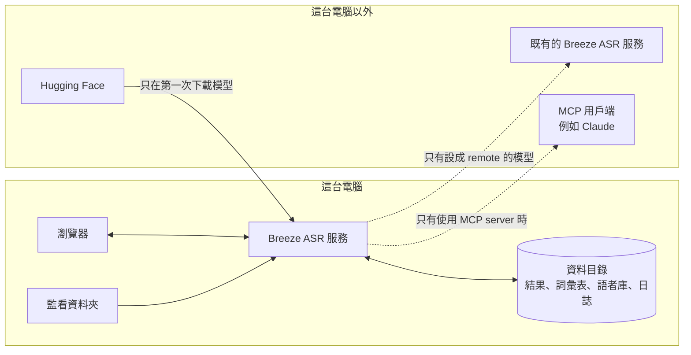

# 安全性

## 部署範圍

本服務是給個人電腦或受信任的區網使用的工具。

> [!WARNING]
> **沒有登入驗證**。任何連得到服務的電腦都能上傳音訊、讀取與修改辨識結果、修改詞彙表、燒錄字幕、取消工作、切換硬體設定，以及檢視和刪除語者庫。

- 不要把服務直接暴露到網際網路。需要從外部使用時，請放在有驗證機制的反向代理或 VPN 後面。
- `.env.example` 設定為只監聽 `127.0.0.1`（`ASR_HOST`、`ASR_PUBLISH_ADDRESS`）；改成 `0.0.0.0` 前請先確認哪些電腦連得到。

## 資料

圖的文字說明：瀏覽器、監看資料夾、Breeze ASR 服務與資料目錄都在同一台電腦上，錄音與結果不會離開這台電腦。對外連線只有三種：第一次啟動時從 Hugging Face 下載模型；`models.json` 設成 `remote` 的模型，會把音訊送到指定的 Breeze ASR 服務；使用 MCP server 時，逐字稿會交給 MCP 用戶端（例如 Claude）。

- 上傳的音訊解碼後存在 `ASR_DATA_DIR`，辨識完成即刪除；結果在 `ASR_JOB_TTL_SECONDS` 到期後刪除。
- 燒錄字幕時上傳的影片在燒完後刪除；燒好的影片放在 `ASR_DATA_DIR/renders`，到 `ASR_JOB_TTL_SECONDS` 或服務重新啟動時刪除。
- 詞彙表（熱詞與取代規則）存在 `ASR_DATA_DIR/glossary.json`，人名等內容只留在本機。
- 日誌存在 `ASR_DATA_DIR/logs/`，會記上傳的檔名，不記字幕內容、熱詞內容與人名；每個檔案滿 5 MB 換新、保留最近 5 個。
- 啟用監看資料夾時，服務會讀取 `ASR_WATCH_DIR` 裡的錄音，並在同一個資料夾寫出結果檔與 `.error.txt`；不會刪除或修改原檔。
- 語者庫的聲紋屬於個人生物特徵，只存在 `ASR_DATA_DIR/voices/`，不會送到外部服務。請依所在地的個人資料法規取得說話者同意，並在不需要時從「語者庫」刪除。
- 只有第一次下載模型時會連到 Hugging Face；轉呼叫遠端服務的模型會把音訊送到 `models.json` 指定的網址。
- 命令列工具與 MCP server 只把檔案送到 `.env` 指定的服務；但 MCP server 會把逐字稿交給呼叫它的 MCP 用戶端（例如 Claude），內容可能因此送到外部 AI 服務。
- `.env` 可能含遠端服務的 API 金鑰，已列在 `.gitignore`，不要提交。

## 已有的防護

- 上傳檔只允許常見音訊／影片容器格式與本機檔案協定，避免偽裝成音檔的播放清單讀取其他檔案或網址。
- 瀏覽器從其他網站送來的寫入請求（`POST`、`PUT`、`PATCH`、`DELETE`）一律拒絕，開著的其他網頁無法替你上傳、修改字幕與詞彙表、取消工作或改動語者庫。
- 單檔大小、音訊長度與排隊數量都有上限（`ASR_MAX_UPLOAD_MB`、`ASR_MAX_AUDIO_SECONDS`、`ASR_MAX_QUEUE`）。
- Docker 映像檔以非 root 使用者執行。

## 回報漏洞

請不要在公開的 issue 回報安全性問題。請使用 GitHub 的 [Private vulnerability reporting](https://docs.github.com/zh/code-security/security-advisories/guidance-on-reporting-and-writing-information-about-vulnerabilities/privately-reporting-a-security-vulnerability)（repo 的 Security 分頁 → Report a vulnerability），附上影響範圍與重現步驟。收到後會盡快回覆並在修正後公開說明。

## 支援的版本

只有 `main` 分支的最新版本會收到安全性修正。
