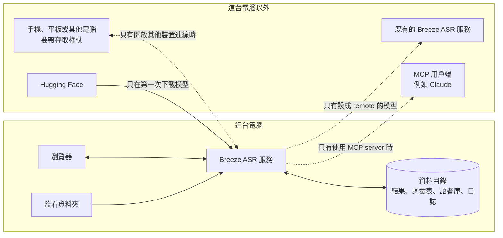

# 安全性

## 部署範圍

本服務是給個人電腦、自己的手機平板，或受信任的區網使用的工具。

> [!WARNING]
> **只有一組共用的存取權杖，沒有帳號與權限之分**。連得到服務又有權杖的人（`ASR_ACCESS_TOKEN=off` 時則是任何連得到服務的人），都能上傳音訊、讀取與修改辨識結果、修改詞彙表、燒錄字幕、取消工作、切換硬體設定，以及檢視和刪除語者庫。

- `.env.example` 只監聽 `127.0.0.1`（`ASR_HOST`、`ASR_PUBLISH_ADDRESS`），`ASR_ACCESS_TOKEN` 是 `off`。`ASR_HOST` 不是本機位址時沒設權杖，服務會拒絕啟動；Docker 版的容器內一律監聽 `0.0.0.0`，所以一定要設定。
- 用 `tailscale serve` 或反向代理開放給其他裝置時，`ASR_HOST` 仍是 `127.0.0.1`，服務不會強制要求權杖，請自己設定 `ASR_ACCESS_TOKEN`。
- 不要把服務直接暴露到網際網路，有權杖也一樣；從外面使用請透過只限自己裝置的 `tailscale serve` 或 VPN，不要用 `tailscale funnel`。
- 以 http 連線時，權杖、錄音與逐字稿都以明文傳送；離開這台電腦的連線請用 HTTPS（`tailscale serve` 或 HTTPS 反向代理）。
- 權杖外流或手機遺失時，改掉 `.env` 的 `ASR_ACCESS_TOKEN` 並重新啟動服務，所有瀏覽器的登入都會失效。

設定方式見[存取權杖](docs/configuration.md#存取權杖)、[接受的主機名稱](docs/configuration.md#接受的主機名稱)與[從手機或平板使用](docs/deployment.md#從手機或平板使用)。

## 資料

圖的文字說明：瀏覽器、監看資料夾、Breeze ASR 服務與資料目錄都在這台電腦上，錄音與結果不會離開這台電腦。對外連線只有四種：開放手機、平板或其他電腦連線時，錄音與逐字稿在那台裝置與服務之間傳送；第一次啟動時從 Hugging Face 下載模型；`models.json` 設成 `remote` 的模型，會把音訊送到指定的 Breeze ASR 服務；使用 MCP server 時，逐字稿會交給 MCP 用戶端（例如 Claude），可能因此送到外部 AI 服務。

- 上傳的音訊解碼後存在 `ASR_DATA_DIR`，辨識完成即刪除；結果在 `ASR_JOB_TTL_SECONDS` 到期後刪除。
- 燒錄字幕上傳的影片燒完即刪除；燒好的影片放在 `ASR_DATA_DIR/renders`，到 `ASR_JOB_TTL_SECONDS` 或服務重新啟動時刪除。
- 詞彙表（熱詞與取代規則）存在 `ASR_DATA_DIR/glossary.json`。
- 語者庫的聲紋屬於個人生物特徵，只存在 `ASR_DATA_DIR/voices/`，不會送到外部服務。請依所在地的個人資料法規取得說話者同意，不需要時從「語者庫」刪除。
- 日誌存在 `ASR_DATA_DIR/logs/`，會記上傳的檔名，不記字幕內容、熱詞內容、人名與權杖（包括送來的錯誤權杖）；瀏覽器回報的 JavaScript 錯誤訊息照原文記下。見[日誌](docs/deployment.md#日誌)。
- 監看資料夾：服務讀取 `ASR_WATCH_DIR` 裡的錄音，在同一個資料夾寫出結果檔與 `.error.txt`，不會刪除或修改原檔。
- 從手機、平板或其他電腦上傳與錄音時，處理方式和在這台電腦上傳相同；手機只留下瀏覽器的下載檔與登入用的 cookie。
- 命令列工具與 MCP server 只把檔案送到 `.env` 指定的服務。
- `.env` 含存取權杖，也可能含遠端服務的 API 金鑰，已列在 `.gitignore`，不要提交。
- OpenVINO 與 NNCF 預設會把用量統計（套件版本、作業系統、權重壓縮參數與一組固定的識別碼，不含錄音與字幕）送到 Google Analytics。推論子行程每次啟動、載入 OpenVINO 之前，會寫入 OpenVINO 自己的設定檔把它關閉（Windows 是 `%LOCALAPPDATA%\Intel Corporation\openvino_telemetry`，Linux、macOS 是 `~/intel/openvino_telemetry`），所以這台電腦上其他 OpenVINO 工具的用量回報也會一起關閉。Hugging Face 的用量回報由 `.env` 的 `HF_HUB_DISABLE_TELEMETRY=1` 關閉。

## 已有的防護

- 設定 `ASR_ACCESS_TOKEN` 後，除了健康檢查、登入端點與網頁本身的靜態檔案，所有請求（包括 API 規格與匯出、下載）都要帶權杖：程式用 `Authorization: Bearer`，瀏覽器用登入後的 cookie。權杖以固定時間比對。
- 登入用的 cookie 是 `HttpOnly`、`SameSite=Strict`，以 HTTPS 開啟時加上 `Secure`；值是由權杖導出的雜湊，不是權杖本身。
- 一分鐘內登入錯 10 次，這一分鐘內的登入一律拒絕，連正確的權杖也一樣。
- 上傳檔只允許常見音訊／影片容器格式與本機檔案協定，避免偽裝成音檔的播放清單讀取其他檔案或網址。
- 瀏覽器從其他網站送來的寫入請求（`POST`、`PUT`、`PATCH`、`DELETE`）一律拒絕，開著的其他網頁無法替你送出這些操作。
- `Host` 標頭不在 `ASR_ALLOWED_HOSTS` 裡的請求一律回 400（包括網頁本身與健康檢查），用來擋 DNS rebinding：惡意網站把自己的網域改指向 `127.0.0.1` 後，瀏覽器把請求當成同一個網站（`Sec-Fetch-Site` 是 `same-origin`），上一條擋不住，`ASR_ACCESS_TOKEN=off` 時對方的網頁就能讀取、修改資料；這種請求的 `Host` 是對方的網域，所以會被拒絕。設了權杖時，權杖與 cookie 也不會帶給對方的網域。
- 單檔大小、音訊長度與排隊數量都有上限（`ASR_MAX_UPLOAD_MB`、`ASR_MAX_AUDIO_SECONDS`、`ASR_MAX_QUEUE`）。
- Docker 映像檔以非 root 使用者執行。

## 回報漏洞

請不要在公開的 issue 回報安全性問題。請使用 GitHub 的 [Private vulnerability reporting](https://docs.github.com/zh/code-security/security-advisories/guidance-on-reporting-and-writing-information-about-vulnerabilities/privately-reporting-a-security-vulnerability)（repo 的 Security 分頁 → Report a vulnerability），附上影響範圍與重現步驟。收到後會盡快回覆並在修正後公開說明。

## 支援的版本

只有 `main` 分支的最新版本會收到安全性修正。
