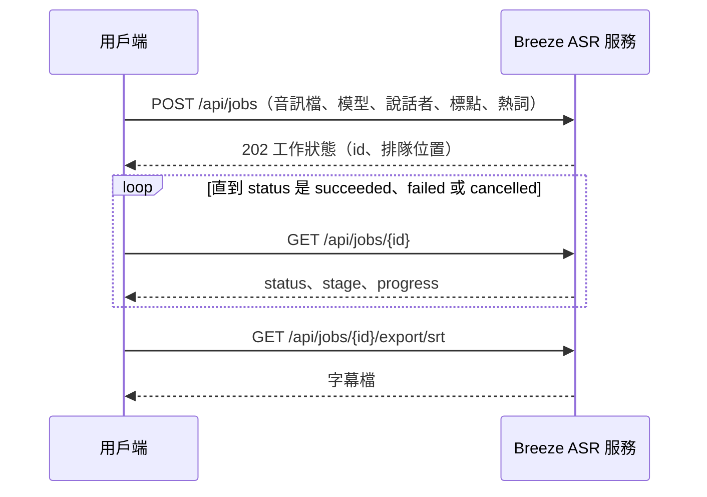

# API

[README](../README.md) · [部署](deployment.md) · [設定](configuration.md) · [運作方式](how-it-works.md) · **API** · [命令列與 MCP](cli.md) · [效能實測](benchmarks.md)

網頁用的就是這組 API。所有路徑都在 `/api` 底下，錯誤回應是 `{"detail": "原因"}`；欄位缺少或型別錯誤時回 422，`detail` 是陣列。OpenAPI 規格在 `/api/openapi.json`。

> [!NOTE]
> 瀏覽器從其他網站送來的 `POST`、`PUT`、`PATCH`、`DELETE`（`Sec-Fetch-Site` 是 `cross-site` 或 `same-site`）一律回 403；curl 等不帶這個標頭的程式不受影響。

## 一次完整的辨識

```bash
curl -F model=MediaTek-Research/Breeze-ASR-25 -F speakers=auto -F punctuation=on -F file=@meeting.m4a http://127.0.0.1:7860/api/jobs
curl http://127.0.0.1:7860/api/jobs/<id>
curl -o meeting.srt http://127.0.0.1:7860/api/jobs/<id>/export/srt
```



圖的文字說明：用戶端以 `POST /api/jobs` 送出音訊檔與選項，服務回 202 與工作編號；之後反覆呼叫 `GET /api/jobs/{id}` 查詢狀態與進度，直到工作結束；成功時再用 `GET /api/jobs/{id}/export/{fmt}` 下載需要的格式。

## 端點一覽

| 方法 | 路徑 | 說明 |
| --- | --- | --- |
| `GET` | [`/api/health`](#get-apihealth) | 服務是否正常運作 |
| `GET` | [`/api/config`](#get-apiconfig) | 模型、硬體、分辨說話者、自動標點、監看資料夾的狀態，匯出格式與上限設定 |
| `POST` | [`/api/hardware/retune`](#post-apihardwareretune) | 重新調校 |
| `POST` | [`/api/hardware/settings`](#post-apihardwaresettings) | 改用另一個實測過的設定 |
| `GET` | [`/api/glossary`](#get-apiglossary) | 讀取詞彙表（熱詞與取代規則） |
| `PUT` | [`/api/glossary`](#put-apiglossary) | 儲存詞彙表 |
| `POST` | [`/api/hotwords/count`](#post-apihotwordscount) | 計算熱詞的 token 數與上限 |
| `GET` | [`/api/jobs`](#get-apijobs) | 列出保留中的工作 |
| `POST` | [`/api/jobs`](#post-apijobs) | 建立辨識工作 |
| `GET` | [`/api/jobs/{id}`](#get-apijobsid) | 查詢工作狀態與結果 |
| `DELETE` | [`/api/jobs/{id}`](#delete-apijobsid) | 取消排隊中或處理中的工作 |
| `PUT` | [`/api/jobs/{id}/transcript`](#put-apijobsidtranscript) | 用整份字幕取代結果（改時間、分割、合併、刪除、改說話者） |
| `PATCH` | [`/api/jobs/{id}/speakers/{speaker_id}`](#patch-apijobsidspeakersspeaker_id) | 替說話者改名 |
| `PATCH` | [`/api/jobs/{id}/segments/{index}`](#patch-apijobsidsegmentsindex) | 修改一段字幕的文字 |
| `GET` | [`/api/jobs/{id}/export/{fmt}`](#get-apijobsidexportfmt) | 下載結果 |
| `POST` | [`/api/jobs/{id}/renders`](#post-apijobsidrenders) | 把字幕燒進原始影片 |
| `GET` | [`/api/renders/{id}`](#get-apirendersid) | 查詢燒錄進度 |
| `DELETE` | [`/api/renders/{id}`](#delete-apirendersid) | 取消燒錄 |
| `GET` | [`/api/renders/{id}/file`](#get-apirendersidfile) | 下載燒好字幕的影片 |
| `GET` | [`/api/voices`](#get-apivoices) | 語者庫清單 |
| `POST` | [`/api/voices`](#post-apivoices) | 記住說話者的聲音 |
| `DELETE` | [`/api/voices/{id}`](#delete-apivoicesid) | 從語者庫刪除 |

## GET /api/health

**回應：** 200 `{"status": "ok"}`

## GET /api/config

**回應：** 200

| 欄位 | 說明 |
| --- | --- |
| `default_model` | 預設模型的 id |
| `models` | 每個模型的 `id`、`name`、`tagline`、`description`、`backend`（`local`／`remote`）、`hotwords`（是否支援熱詞）、`state`、`error`、`seconds_per_audio_second` |
| `hardware` | 調校狀態（`state`：`starting`、`tuning`、`ready`、`failed`、`not_needed`）、使用中的設定與實測紀錄 |
| `speakers` | 分辨說話者模型的狀態、`max_speakers`、`max_name_length`；沒有提供這個功能時是 `null` |
| `punctuation` | 標點模型的狀態（`state`：`downloading`、`ready`、`failed`）；沒有提供這個功能時是 `null` |
| `watch` | 監看資料夾的設定與狀態（`directory`、`model`、`speakers`、`punctuation`、`formats`、處理中的 `active`、已完成的 `processed`、`error`）；沒有監看時是 `null` |
| `formats` | 可匯出的格式 |
| `max_upload_mb`、`max_audio_seconds` | 上傳上限 |
| `max_text_length`、`max_hotwords_length` | 一段字幕、熱詞的字數上限 |

模型的 `state`：`waiting`、`downloading`、`converting`、`prepared`、`loading`、`ready`、`failed`。

## POST /api/hardware/retune

重新偵測硬體，把預設模型重新轉成要實測的權重格式並實測（Core i7-9700 上約 7–9 分鐘，Core Ultra 7 155U 上約 7 分鐘），期間無法辨識。

**回應：**
- 202：新的調校狀態
- 409：還有工作在排隊或處理中，或正在調校中

## POST /api/hardware/settings

改用實測紀錄裡的另一個設定，`application/json`：`{"label": "Intel(R) UHD Graphics 630 (iGPU)（OpenVINO GPU・int8）"}`，`label` 取自 `GET /api/config` 的 `hardware.tuning.candidates[].label`。只能選實測時跑得起來的項目（錯誤率不合格的也可以選）；會依該項目量到的記憶體重新決定常駐模型數，寫回硬體設定檔，再重新啟動推論子行程。該格式已被調校清掉時，第一次使用會重新轉換。

**回應：**
- 202：新的硬體狀態
- 409：還有工作在排隊或處理中，或推論設定還沒就緒
- 422：設定檔沒有實測紀錄、找不到這個設定，或它實測時無法執行

## GET /api/glossary

**回應：** 200 `{"hotwords": "…", "replacements": [{"find": "鍾雲浩", "replace": "鍾昀澔"}]}`。還沒存過時兩者都是空的。

## PUT /api/glossary

整份取代詞彙表，`application/json`，格式同上。熱詞最多 1000 字；取代規則最多 500 條，`find` 不可空白、`find` 與 `replace` 各最多 100 字，`replace` 可以是空字串（刪掉那段文字）；兩者相同的規則會略過。連續空白與換行會合併成一個空格。

取代規則會自動套用到之後完成的辨識結果（在加標點之前），依清單順序逐條取代；已有的結果不受影響。

**回應：** 200 儲存後的詞彙表，或 422（格式不對）

## POST /api/hotwords/count

`application/json`：`{"model": "MediaTek-Research/Breeze-ASR-25", "text": "與會者有王小明、陳美玲。"}`

**回應：**
- 200：`{"tokens": 18, "limit": 223}`。`tokens` 是熱詞的 token 數，`limit` 是這個模型能接受的上限（`max_target_positions` 的一半減一）
- 400：不支援的模型
- 422：這個模型轉呼叫外部服務，不支援熱詞

## GET /api/jobs

**回應：** 200 `{"jobs": [...]}`，最新的在前。每筆有 `id`、`model`、`filename`、`audio_seconds`、`status`、`stage`、`created_at`、`finished_at`，以及完成後的段數 `segments`（還沒完成是 `null`）。

## POST /api/jobs

建立辨識工作，`multipart/form-data`。

| 欄位 | 必填 | 說明 |
| --- | --- | --- |
| `model` | 是 | `models.json` 裡的模型 id |
| `speakers` | 是 | `off`（不分辨）、`auto`（自動判斷人數）或 2–`max_speakers` 的人數 |
| `punctuation` | 是 | `on` 或 `off`：辨識後自動加標點 |
| `hotwords` | 否 | 熱詞，例如「與會者有王小明、陳美玲，會中提到 Kubernetes。」；不給或空字串表示不用。最多 1000 字，且不可超過模型的 token 上限 |
| `file` | 是 | 音訊或影片檔 |

**回應：**
- 202：工作狀態（格式同 [`GET /api/jobs/{id}`](#get-apijobsid)），另外多一個 `waveform`：把整段音訊等分成 4000 格、每格的峰值（0–1），網頁在瀏覽器無法自行解碼時用它畫波形
- 400：不支援的模型，`speakers`、`punctuation` 不合法，或這個服務沒有提供要求的功能
- 411：請求缺少 `Content-Length`
- 413：檔案超過 `ASR_MAX_UPLOAD_MB`
- 422：無法解碼、音訊超過 `ASR_MAX_AUDIO_SECONDS`、熱詞太長，或轉呼叫外部服務的模型給了熱詞
- 503：排隊的工作已達 `ASR_MAX_QUEUE`

## GET /api/jobs/{id}

**回應：** 200，或 404（找不到或已過期）

| 欄位 | 說明 |
| --- | --- |
| `id`、`model`、`filename`、`audio_seconds` | 工作的基本資料 |
| `status` | `queued`、`running`、`succeeded`、`failed`、`cancelled` |
| `stage` | 處理中的階段：`preparing`、`loading`、`transcribing`、`punctuating`、`diarizing` |
| `speakers_mode` | 建立時的 `speakers` |
| `punctuation`、`hotwords` | 建立時是否自動加標點、使用的熱詞 |
| `created_at`、`finished_at` | Unix 時間 |
| `error` | 失敗原因 |
| `queue_position`、`jobs_ahead` | 只在排隊中出現 |
| `stage_elapsed_seconds` | 辨識或分辨說話者階段已經過的秒數 |
| `progress`、`estimated_seconds` | 辨識進度（0–1，OpenVINO 不提供）與預估總秒數（依自動調校實測與先前工作的平均速度），無法得知時為 `null` |
| `speakers_progress` | 分辨說話者的進度（0–1） |
| `result` | 完成後才有，見下方 |

`result`：

```json
{
  "revision": 0,
  "punctuation_error": null,
  "text": "完整文字",
  "segments": [{ "start": 0.0, "end": 4.24, "text": "那顯然這樣子的 attention 是有問題的", "speaker": "S1" }],
  "speakers": [{ "id": "S1", "name": "說話者 1", "seconds": 26.0, "voice_id": null, "similarity": null }],
  "voiceprint_speakers": ["S1"],
  "speakers_error": null,
  "audio_seconds": 29.11,
  "processing_seconds": 18.4
}
```

不分辨說話者時 `speaker` 與 `speakers` 是 `null`；分辨說話者失敗時 `speakers_error` 說明原因，字幕照常產生。`punctuation_error` 是自動標點失敗的原因（字幕保留沒有標點的版本）。`voiceprint_speakers` 是有聲紋、可以「記住聲音」的說話者編號，包括已被合併掉的（復原時會用到）；手動新增的說話者不在裡面。`revision` 是結果的版本號，每次修改加一，[`PUT /api/jobs/{id}/transcript`](#put-apijobsidtranscript) 要帶上目前的值。

## DELETE /api/jobs/{id}

排隊中的工作立即取消。處理中的工作會結束推論子行程再重新啟動，狀態稍後變成 `cancelled`。

**回應：**
- 200：工作狀態
- 404：找不到工作
- 409：工作已經結束

## PUT /api/jobs/{id}/transcript

用整份字幕取代結果，`application/json`。網頁的改文字、改時間、分割、合併、刪除、改說話者、合併說話者、尋找取代與復原都是送這個請求（只有在「說話者」面板改名字用 [`PATCH …/speakers/{speaker_id}`](#patch-apijobsidspeakersspeaker_id)）。

```json
{
  "revision": 3,
  "segments": [{ "start": 0.0, "end": 4.24, "text": "那顯然這樣子的 attention 是有問題的", "speaker": "S1" }],
  "speakers": [{ "id": "S1", "name": "王小明", "voice_id": null, "similarity": null }]
}
```

- `revision` 必須等於目前結果的版本號，避免覆蓋在別的分頁做的修改。
- 字幕依開始時間排序；每段的結束時間要晚於開始時間，而且在音訊長度內；時間取到百分之一秒。文字的規則同 [`PATCH …/segments/{index}`](#patch-apijobsidsegmentsindex)，最多 20000 段。
- 沒有分辨說話者的結果，`speakers` 與每段的 `speaker` 都是 `null`；有分辨說話者時，每段的 `speaker` 必須在 `speakers` 裡。`id` 是 S 加數字，可以新增（例如把幾段改給新的說話者 `S5`），新增的人沒有聲紋，不能「記住聲音」。新的編號不要用 `voiceprint_speakers` 裡的編號，否則會沿用那位說話者原本的聲紋。
- 沒有任何字幕的說話者會被移除（合併說話者就是把字幕都改給另一人）；每人的時間 `seconds` 依字幕重新計算。
- `voice_id` 必須是語者庫裡的人或 `null`。

**回應：** 200 更新後的工作狀態、404（找不到工作）、409（`revision` 不符）、422（內容不合法）

## PATCH /api/jobs/{id}/speakers/{speaker_id}

替說話者改名，JSON：`{"name": "王小明"}`，最多 40 字。

**回應：** 200 更新後的工作狀態、404（找不到工作或說話者），或 422（空白或超過 40 字）

## PATCH /api/jobs/{id}/segments/{index}

修改第 `index` 段（從 0 起算）的文字，JSON：`{"text": "修正後的字幕"}`。連續空白與換行會合併成一個空格，最多 500 字；時間不能改（要改時間、分割或合併，用 [`PUT /api/jobs/{id}/transcript`](#put-apijobsidtranscript)）。結果的 `text` 與之後下載的檔案都會用修改後的文字。

**回應：** 200 更新後的工作狀態、404（找不到工作或這一段），或 422（空白或超過 500 字）

## GET /api/jobs/{id}/export/{fmt}

`fmt` 是下列其中一種，以附件下載，檔名沿用上傳的檔名。

| 格式 | 內容 |
| --- | --- |
| `txt` | 純文字，同一人連續說的話併成一段 |
| `srt`、`vtt` | 字幕；說話者以「名字：」或 VTT 的 `<v 名字>` 標示 |
| `ass` | 字幕，字型取自 `ASR_SUBTITLE_FONT`，說話者名字放在 `Name` 欄位與文字前 |
| `md` | 逐字稿：檔名、長度、說話者清單，內文是 `[時:分:秒] **說話者**：…`，同一人連續的話併成一段、每段最長約 2 分鐘 |
| `docx` | Word 逐字稿，內容同 `md` |
| `json` | 每段的起訖秒數、文字、說話者 |

**回應：**
- 200：檔案內容
- 404：找不到工作，或不支援的格式
- 409：工作還沒有辨識結果

## POST /api/jobs/{id}/renders

把目前已儲存的字幕燒進影片畫面，`multipart/form-data`，欄位 `file` 是這份字幕的原始影片。影片長度必須和辨識時的音訊相差 2 秒以內。輸出是 H.264／AAC 的 MP4，字幕樣式同 ASS 匯出；一次燒一支，其他排隊。

**回應：**
- 202：`{"id", "job_id", "status", "progress", "error", "filename", "created_at", "finished_at"}`
- 404：找不到工作
- 409：工作還沒有辨識結果
- 413：檔案超過 `ASR_MAX_UPLOAD_MB`
- 422：檔案沒有影像、讀不到長度，或長度不符
- 503：排隊的燒錄工作已達 `ASR_MAX_QUEUE`

## GET /api/renders/{id}

**回應：** 200 燒錄狀態（格式同上），`status` 是 `queued`、`running`、`cancelling`、`succeeded`、`failed`、`cancelled`，`progress` 是 0–1；或 404（找不到或已過期）。燒好的影片和辨識結果一樣保留 `ASR_JOB_TTL_SECONDS`；服務重新啟動時會清掉。

## DELETE /api/renders/{id}

**回應：** 200 燒錄狀態、404（找不到）或 409（已經結束）

## GET /api/renders/{id}/file

**回應：** 200 MP4 檔（附件），檔名是「原檔名-字幕.mp4」；404（找不到或已過期），或 409（還沒完成）

## GET /api/voices

**回應：** 200 `{"voices": [...]}`，每筆有 `id`、`name`、`samples`、`outdated`、`created_at`、`updated_at`，不含聲紋本身。沒有提供分辨說話者時回 404。

## POST /api/voices

把某個結果裡的說話者以目前的名字記進語者庫。同名的人會累加聲紋。

```json
{ "job_id": "…", "speaker_id": "S1" }
```

**回應：**
- 201：`{"voice": {"id", "name", "samples"}, "job": 更新後的工作狀態}`
- 404：找不到工作或說話者，或這位說話者沒有聲紋（手動新增的說話者，見 `voiceprint_speakers`）
- 422：說話者還是預設名字，請先取名

## DELETE /api/voices/{id}

**回應：** 200 `{"voices": [...]}` 刪除後的清單，或 404（語者庫裡沒有這個人）
