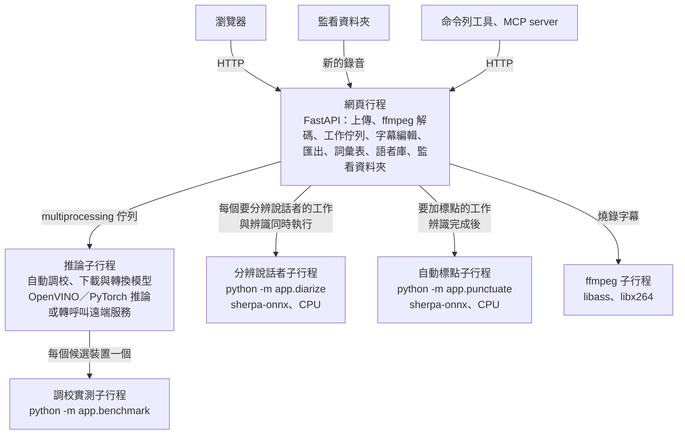

# 運作方式

## 架構

圖的文字說明：

- 瀏覽器透過 HTTP 連到網頁行程。網頁行程用 FastAPI 處理上傳、用 ffmpeg 解碼音訊，並負責工作佇列、字幕編輯、匯出、詞彙表、語者庫與監看資料夾。
- 網頁行程透過 multiprocessing 佇列把工作交給推論子行程；推論子行程負責自動調校、下載與轉換模型，再用 OpenVINO 或 PyTorch 推論，或轉呼叫遠端服務。
- 要分辨說話者的工作，網頁行程另外為它啟動一個分辨說話者子行程，和辨識同時執行，只用 CPU。
- 自動調校時，推論子行程為每個候選裝置各啟動一個調校實測子行程。
- 要加標點的工作，辨識完成後網頁行程啟動一個自動標點子行程；燒錄字幕時啟動 ffmpeg。
- 監看資料夾的新檔案由網頁行程自己送進同一個工作佇列；命令列工具與 MCP server 是另外的程式，透過 HTTP 呼叫執行中的服務。

| 路徑 | 內容 |
| --- | --- |
| `app/__main__.py`、`app/logsetup.py` | 啟動服務；日誌（終端機與 `ASR_DATA_DIR/logs`，見[部署](deployment.md#日誌)） |
| `app/main.py` | FastAPI 路由與服務組裝 |
| `app/config.py`、`app/catalog.py` | `.env` 設定與 `models.json` 的讀取與檢查 |
| `app/jobs.py`、`app/transcript.py` | 工作佇列、結果保存與過期清理、字幕編輯與版本號；逐字稿資料結構 |
| `app/inference.py`、`app/engine.py`、`app/preparation.py` | 推論子行程；模型的下載、轉換、載入與卸載；編譯快取的清理 |
| `app/backend_openvino.py`、`app/backend_torch.py`、`app/backend_remote.py` | 三種推論方式 |
| `app/tune.py`、`app/benchmark.py`、`app/hardware.py` | 自動調校、單一裝置實測、硬體設定檔 |
| `app/segmentation.py` | 句子分段 |
| `app/diarize.py`、`app/speakers.py`、`app/voices.py` | 分辨說話者、對到字幕、語者庫 |
| `app/audio.py`、`app/exports.py` | ffmpeg 解碼與讀取影片資訊；TXT／SRT／VTT／ASS／Markdown／DOCX／JSON 匯出 |
| `app/hotwords.py`、`app/glossary.py` | 熱詞的 token 計數與上限；詞彙表（熱詞與取代規則） |
| `app/punctuate.py`、`app/punctuation.py` | 自動標點子行程與把標點放回原文的對齊；標點模型的下載與呼叫 |
| `app/renders.py` | 燒錄字幕的佇列與 ffmpeg 呼叫 |
| `app/watch.py` | 監看資料夾 |
| `app/client.py`、`app/cli.py`、`app/mcp_server.py` | 呼叫服務的 HTTP 客戶端；命令列工具；MCP server |
| `static/` | 前端（純 HTML／CSS／JavaScript，不需建置） |

- OpenVINO 把模型編譯到內顯時會鎖住 Python GIL（首次約 30 秒到 1 分半，依內顯而定；之後讀編譯快取只要十幾秒）；推論放在子行程，網頁在這段期間仍能即時回應。
- 推論子行程若因驅動程式錯誤或記憶體不足而結束，網頁行程會在 5 秒後自動重啟它。已經開始辨識的工作以錯誤結束，避免同一個會讓它崩潰的檔案反覆重跑；還沒開始處理的工作在重啟後自動重送一次。
- 啟動時先下載、轉換所有本機模型，全部準備好之後才預先載入預設模型，避免轉換時和已載入的模型搶記憶體；準備期間送出的工作會在需要時才載入模型。
- 取消處理中的工作時，會結束推論子行程（連同它正在轉換模型的子行程）再重新啟動，所以已載入的模型要重新載入。
- 上傳檔用內建的 ffmpeg 解碼，只允許常見音訊／影片容器格式與本機檔案協定，避免偽裝成音檔的播放清單讀取其他檔案或網址。
- 長音檔沿用 Whisper 原生的逐段（sequential）長音訊解碼，與官方 [`run.py`](https://github.com/mtkresearch/Breeze-ASR-25/blob/main/run.py) 用 `chunk_length_s=0` 的建議一致。

## 推論方式

| 方式 | 適用硬體 | 說明 |
| --- | --- | --- |
| 本機 OpenVINO | Intel／AMD CPU、Intel 內顯 | 權重先轉成 OpenVINO IR（權重格式由自動調校決定），再用 [OpenVINO GenAI](https://github.com/openvinotoolkit/openvino.genai) 的 `WhisperPipeline` 推論；不回報進度，狀態列改顯示預估時間（依自動調校實測與先前工作的平均速度） |
| 本機 PyTorch | NVIDIA GPU（CUDA）、AMD GPU（ROCm，僅 Linux） | 沿用官方 `run.py` 的 transformers pipeline，進度顯示實際進度；ROCm 版 PyTorch 沿用同一套 `cuda` 介面 |
| 遠端 | 不佔本服務資源 | 轉呼叫既有的 Breeze ASR 服務（`/v1/transcribe/jobs` 介面），進度沿用它回報的 `progress` |

本機模型用哪個引擎、裝置與權重格式由自動調校決定。

## 自動調校

第一次啟動時（`ASR_HARDWARE_PROFILE` 指向的檔案還不存在），推論子行程會先為這台電腦挑出最快的設定，進度顯示在狀態列；期間送出的工作會等調校完成後自動開始。

1. 偵測硬體：CPU、記憶體、OpenVINO 看得到的裝置、PyTorch 看得到的 GPU（CUDA 或 ROCm）。每個 OpenVINO 裝置記錄它回報的運算精度（`OPTIMIZATION_CAPABILITIES`）、內顯或獨顯（`DEVICE_TYPE`）與可用的 GPU 記憶體（`GPU_DEVICE_TOTAL_MEM_SIZE`）。
2. 讀預設模型的 safetensors 檔頭，得到原始精度與參數量，不看 `config.json`（Breeze ASR 25 的 `config.json` 寫 float32，實際是 bf16；Breeze ASR 26 是 fp32；兩者都是 1,543,304,960 個參數）。
3. 列出組合：每個 OpenVINO 裝置（NPU 除外）× int4、int8、fp16、fp32。裝置以它回報的最窄浮點精度運算（CPU 多半是 FP32，內顯是 FP16，有 AMX 的 CPU 是 BF16），比運算精度寬的浮點格式不測，例如 GPU 的 fp32；比原始權重寬的也不測，例如 Breeze ASR 25 的 fp32 只會保留原本的 bf16。
4. 依序實測：先 CPU（取得錯誤率基準），再 GPU 與 PyTorch；同一裝置由小到大（int4 → int8 → fp16 → fp32）。每項以內附的 29 秒範例語音（`app/assets/tune-sample.ogg`）暖機一次再量兩次、取較快的一次，並比對參考逐字稿算字元錯誤率。每項在獨立的子行程裡測，出錯、當掉或超過 15 分鐘只淘汰那一項。
5. 每項開始前依序檢查，任一成立就略過並寫明原因：
   - 錯誤率：錯誤率主要由權重格式決定，在 CPU 上超過 15%，或比最準的設定高出超過 1 個百分點的格式，不再拿到其他裝置測。
   - 裝置故障：某裝置第一個實測的項目就當掉或逾時，該裝置其餘格式不再測，壞掉的裝置最多只耗一次逾時。
   - 記憶體（只檢查 fp16、fp32）：預估 = 參數量 × 權重格式的大小 ＋ 已實測項目中最小的「私有記憶體 − 權重大小」。權重不以裝置的運算精度計算：在 Core Ultra 7 155U 上實測，CPU 跑 fp16 的私有記憶體是 5.2 GB，比整份展開成 fp32 的 6.2 GB 還少。上限是當下的系統可用記憶體，內顯再以裝置回報的 GPU 記憶體為上限，獨顯直接用 GPU 記憶體。int8、int4 一律實測不檢查：它們是最小的格式，也是錯誤率的比較基準，當下記憶體暫時吃緊時不能因此讓整輪調校沒有結果。
6. 只有真的要實測的格式才轉換：OpenVINO 從 PyTorch 以原始精度匯出一次（最花時間、最吃記憶體的一步），其他格式再從它壓縮權重，壓縮設定與 `optimum-cli --weight-format` 的預設相同。被略過的格式不轉換；已經轉好的格式直接沿用。
7. 選最快的；但 GPU 與最快的 CPU 差距在 15% 以內時改用 GPU，讓 CPU 留給使用者的其他工作。
8. 依量到的單一模型私有記憶體與目前可用記憶體（最多用一半；NVIDIA 為可用顯示記憶體的 80%）決定同時常駐幾個模型。
9. 刪掉沒選上的格式，只留選中的那一份；寫出硬體設定檔，之後啟動直接讀它，不再調校。被刪掉的格式的編譯快取，會在推論子行程這次啟動時一併清掉（見[編譯快取](#編譯快取)）。

| 裝置 | 處理方式 |
| --- | --- |
| Intel／AMD CPU | 測 OpenVINO 各格式（原始權重是 16 位元時不測 fp32；CPU 上比 PyTorch 快，PyTorch CPU 不測） |
| Intel 內顯／獨顯 | 測 OpenVINO int4、int8、fp16 中在 CPU 上錯誤率合格的格式 |
| Intel NPU | 不測，列為未測試：在 Core Ultra 7 155U 上編譯約 10 分鐘後，推論時驅動回報 `DEVICE_LOST`、裝置被重置 |
| NVIDIA GPU | 測 PyTorch fp16；須安裝 CUDA 版 PyTorch（`uv sync --no-default-groups --group cu130`），否則列為未測試並說明原因 |
| AMD GPU | 測 PyTorch fp16；須在 Linux 安裝 ROCm 版 PyTorch（`uv sync --no-default-groups --group rocm72`），偵測到 `rocm-smi` 或 `amd-smi` 但沒裝時列為未測試並說明原因 |

工具列的「硬體」顯示偵測到的硬體、各裝置實測結果、選擇理由與未測試的裝置。實測表裡跑得起來的項目都有「改用」，按兩次確認就切換過去（例如想讓 CPU 空出來給其他工作而改用內顯），推論子行程會重新啟動；也可以「重新調校」。有工作在排隊或處理中時，這兩個操作都不能用。手寫硬體設定檔的格式見[設定](configuration.md#硬體設定檔)。

## 編譯快取

OpenVINO 第一次把模型編譯到某個裝置時會存下編譯結果，之後載入直接讀快取：內顯從約 30 秒縮短到約 6 秒。

- 每個轉換後的模型有自己的快取資料夾 `data/openvino-cache/<轉換後的模型資料夾名稱>`，例如 `MediaTek-Research--Breeze-ASR-25--cffe7ccb404d--int8`；同一個模型在各裝置上的編譯結果都放在這裡。
- 推論子行程每次啟動（包括重新調校與改用其他設定之後）都會清一次：對應的模型已不存在的快取資料夾，以及直接放在 `data/openvino-cache` 底下的舊版快取檔，全部刪除，並在日誌記下刪了幾項、釋出多少空間。
- 模型還在，它的快取資料夾就不會被清。切換 `sentence_segments` 或改用其他裝置後，舊的編譯結果會留在裡面；想清的話，在服務停止時刪掉那個資料夾，下次載入會重新編譯。

## 句子分段

Breeze ASR 26 幾乎不輸出段內時間戳，Whisper 的長音訊解碼只能每 30 秒切一段，而且每段都沒有結束時間，原本產生的字幕是好幾段 30 秒以上、時間互相重疊的長段落。`sentence_segments` 填了物件的模型改用以下流程：

1. 取得逐字時間戳：兩種引擎都依 `generation_config.json` 的 `alignment_heads`，以 DTW 對齊 cross-attention 算出時間。
   - OpenVINO：開啟 GenAI 的 `word_timestamps`，每個字一筆時間。沿用已轉換好的模型，不需要重新匯出。
   - PyTorch（CUDA、ROCm）：transformers pipeline 的 `return_timestamps="word"`。中文會以空白分隔的整個片語為一筆，所以依字數把片語的時間平均分給每個中文字與英文單字。
2. 在句末與子句標點，以及中文字之間的空白（這個模型用空白標示停頓）切段；英文單字前後的空白要真的有停頓才切；30 秒視窗的交界若有停頓也切開。
3. 停頓後的第一個字常把整段停頓算成自己的時間，讓字幕提早好幾秒出現；這種字最長只保留字長中位數的 2 倍（與 Whisper 官方 `timing.py` 的作法相同）。
4. 短於 `min_seconds` 的片段併入相鄰段落（優先併向停頓較短的一側），超過 `max_seconds` 的段落再從最接近中間的分隔處切開。

- 逐字結果與辨識文字對不起來時，該次改用模型原本的分段，並在日誌留下警告。
- 逐字時間戳只影響分段，不影響辨識文字。
- 開關 `sentence_segments` 會讓解碼器重新編譯一次（內顯約 30 秒、CPU 約 35 秒），編譯快取多約 1 GB；舊的快取檔留在同一個模型的快取資料夾裡，不會自動刪除，可以刪掉那個資料夾讓它重建（見[編譯快取](#編譯快取)）。
- 想要最快速度、不在意字幕段落長度時，把 `sentence_segments` 改回 `null`。

切段準確度與速度代價見[效能實測](benchmarks.md#句子分段)。

## 分辨說話者

在工具列的「說話者」選「自動」或指定人數，結果會標出每段是誰說的，下載的 TXT、SRT、ASS、Markdown、DOCX 也帶名字（VTT 用 `<v 名字>` 標記，JSON 多 `speaker`、`speaker_name` 與 `speakers` 欄位）。分錯時可以在「說話者」面板把一位併入另一位，或在「字幕」面板把某一段改給別人或新的說話者。

1. **分段**：用 [sherpa-onnx](https://github.com/k2-fsa/sherpa-onnx) 跑 [pyannote segmentation 3.0](https://huggingface.co/pyannote/segmentation-3.0) 找出每一小段時間有誰在說話，再用 [3D-Speaker](https://github.com/modelscope/3D-Speaker) 的 ERes2Net 聲紋模型分群。
2. **對到字幕**：每個字幕段落歸給說話時間重疊最多的人，完全沒重疊的短句歸給時間上最近的人；說話者依第一次開口的順序編號為「說話者 1、2…」。同一段裡換人說話時，標的是說得比較多的那位。
3. **認人**：在右側「說話者」面板替說話者取名後按「記住聲音」，聲紋就存進語者庫（手動新增的說話者沒有聲紋，不會出現這個按鈕）；之後與語者庫裡某人的相似度達到 `match_threshold` 就自動填上名字，一個人只會對到一位說話者。同一個名字可以記好幾次，在不同場合（麥克風、距離）各記一次會更準。

分辨說話者在獨立的子行程執行，和辨識同時進行、只用 CPU；失敗時（例如模型下載不到）不影響字幕，「說話者」面板會說明原因。

### 分群與合併

- **分塊**：錄音切成每塊 10 分鐘，各塊用 sherpa-onnx 分段分群。sherpa-onnx 會把所有片段的聲紋放在一起算兩兩距離，記憶體隨長度平方成長；分塊後時間與記憶體都只隨長度線性增加。
- **跨塊合併**：塊內的第一輪分群切得很細，每群再取最長的幾段（合計至多 30 秒）重算聲紋，然後反覆合併最像的兩組，直到最像的一對低於 `merge_threshold`。兩組有多像用**平均連結**：兩組成員之間兩兩聲紋相似度的加權平均，而不是兩組平均聲紋的相似度。兩人來回對話時，常有一群同時混到兩個人、聲紋落在兩人中間；用平均聲紋比較，這種群會讓兩人的組一步步靠近而串成同一人，平均連結不會。
- **零碎群**：說話總長不到「`min_speaker_factor` × √(全部說話秒數)」的群（附和、雜音、聲紋取樣太短的片段）併入聲紋最像的群。門檻隨錄音長度增加：57 秒約 4 秒、5 分鐘約 10 秒、1 小時約 40 秒、3 小時約 70 秒。
- **指定人數**：流程相同，但過程中至少保留指定的群數，最後還多的話再一路合併最像的兩組。

### 認人的依據

一個人的聲紋不是一個平均向量，而是組成他的多段聲紋（每人最多 32 段；語者庫裡每人最多保留 128 段），比對用平均連結，`match_threshold` 和 `merge_threshold` 是同一個尺度。

- 同一個房間、同一支麥克風收音時，不同人的平均聲紋相似度可能高達 0.89，同一人在不同時段卻可能只有 0.73，用平均聲紋比對分不開。
- 改用平均連結後，不同人最高 0.65，同一人的主要部分在 0.72 以上；少數零碎的同一人只有 0.4–0.5，這種會認不出來（只是沒填名字，不會填錯）。

### 語者庫與隱私

- 聲紋屬於個人生物特徵。語者庫只存在 `ASR_DATA_DIR/voices/`，不會送到任何外部服務；在工具列的「語者庫」可刪除任何人。
- 每個聲紋模型各自一個檔案（檔名含模型與版本）。換了聲紋模型，語者庫會是空的；舊檔案保留，換回原模型就能再用。
- 辨識結果另外保存各說話者的聲紋（給「記住聲音」用，不會回傳給瀏覽器），和結果一起在 `ASR_JOB_TTL_SECONDS` 到期時刪除。
- 舊版格式（聲紋只存一個平均向量）記住的人仍會列在語者庫，但標示為需要重新記住、不會用來自動認人；在新的辨識結果裡替他再按一次「記住聲音」就會換成新格式。

## 熱詞

Breeze ASR 是 Whisper 架構，可以把一段文字當成「前一段的逐字稿」放在 `<|startofprev|>` 後面，引導模型用指定的寫法。網頁勾選「熱詞」時會帶上「詞彙」裡的熱詞：

- OpenVINO 用 `WhisperPipeline` 的 `hotwords`，每個 30 秒視窗都帶；不用只影響第一個視窗的 `initial_prompt`。
- PyTorch 用 transformers 的 `prompt_ids`，不開 `condition_on_prev_tokens`，同樣每段都帶。
- 熱詞最多佔模型解碼長度的一半減一（Breeze ASR 是 223 個 token）。實測約 390 個 token 時一個視窗可輸出的字數不夠，結果會被截掉，所以送出時就擋下；約 220 個 token 在內顯上慢約 18%，100 個 token 左右幾乎不影響速度。
- 轉呼叫外部服務的模型不支援。

寫成句子（「與會者有王小明、陳美玲，會中提到 Kubernetes。」）比單純列出詞彙有效；只能修正清單裡的詞，同音的常見字人名（例如「昀澔」被寫成「雲浩」）多半修不回來，這種用取代規則處理。實測數字見[效能實測](benchmarks.md#熱詞)。

## 詞彙表與取代規則

詞彙表存在 `ASR_DATA_DIR/glossary.json`，網頁、命令列工具與監看資料夾共用。取代規則在每個新結果完成時依序套用（在加標點之前，讓標點模型看到正確的詞）；已有的結果在「尋找取代」按「套用詞彙表」，可以復原。

## 自動標點

Breeze ASR 的輸出沒有標點。勾選「標點」時，辨識完成後用 [sherpa-onnx](https://github.com/k2-fsa/sherpa-onnx) 跑 FunASR 的 CT-Transformer 中英標點模型：

1. 把所有字幕段落以空白連起來交給模型，讓它看到上下文。
2. 模型會順便刪掉中英文之間的空白，所以不直接用它的輸出，而是逐字對齊原文，只把它加的標點放回去；落在段落交界的標點歸前一段，原文已有的半形標點換成模型選的全形標點。
3. 對不起來（模型改了字）時保留原本沒有標點的文字，資訊面板顯示「標點：失敗」，滑鼠移到上面可以看原因。

1 萬字約 2 秒，在 CPU 上執行；標點模型約 280 MB，第一次啟動時下載。

## 編輯與復原

網頁的修改都送到伺服器保存，下載的檔案與重新整理後看到的都是修改後的版本：

- 文字直接在字幕列表上改；時間、說話者、分割、合併、刪除在右側「字幕」面板，對應原始檔後可以用「設為播放位置」對時，分割時以文字游標（或播放位置）為分界，Ctrl+Enter 也能分割。
- 「說話者」面板可以把一位說話者併入另一位；字幕面板可以把某段改給新的說話者。
- 除了在「說話者」面板改名字（`PATCH …/speakers/{speaker_id}`），其他修改都會把整份字幕連同版本號送出（`PUT /api/jobs/{id}/transcript`），版本號不符就拒絕，避免兩個分頁互相覆蓋。復原、重做（Ctrl+Z、Ctrl+Y）是在瀏覽器記住修改前的整份字幕再送一次，最多 100 步，換工作或重新整理後就清空。

## 找回結果與原始檔

完成的結果保存在 `ASR_DATA_DIR/results`，網頁右側的「工作」列出所有保留中的工作，重新整理後會自動打開上次看的那一份。上傳的音訊辨識完就刪除，所以從清單打開的舊結果只有文字；要播放、看波形、對時或燒錄字幕時，按「對應原始檔…」再選一次原始檔（長度要相差 2 秒以內）。同一個分頁送出的檔案會記在瀏覽器裡，切換工作時自動對應。

影片檔會在右側顯示預覽，播放時把目前的字幕疊在畫面上。

## 燒錄字幕

「匯出」的「燒錄字幕…」把目前已儲存的字幕燒進原始影片，用內建 ffmpeg 的 libass 依 ASS 匯出的樣式（`ASR_SUBTITLE_FONT`）畫字幕，影像重新編碼成 H.264、聲音轉成 AAC，輸出 MP4。燒好的影片放在 `ASR_DATA_DIR/renders`，保留 `ASR_JOB_TTL_SECONDS`，服務重新啟動時清掉；上傳的原始影片在燒完後立即刪除。

## 監看資料夾

見[部署](deployment.md#監看資料夾)。監看資料夾送出的工作和網頁送出的一樣排隊，完成時把 `ASR_WATCH_FORMATS` 的格式寫在原檔旁邊。
